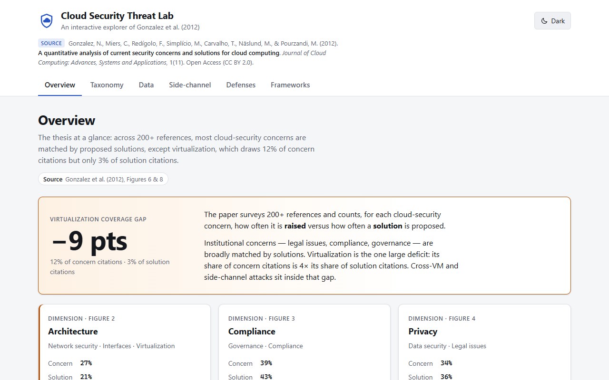
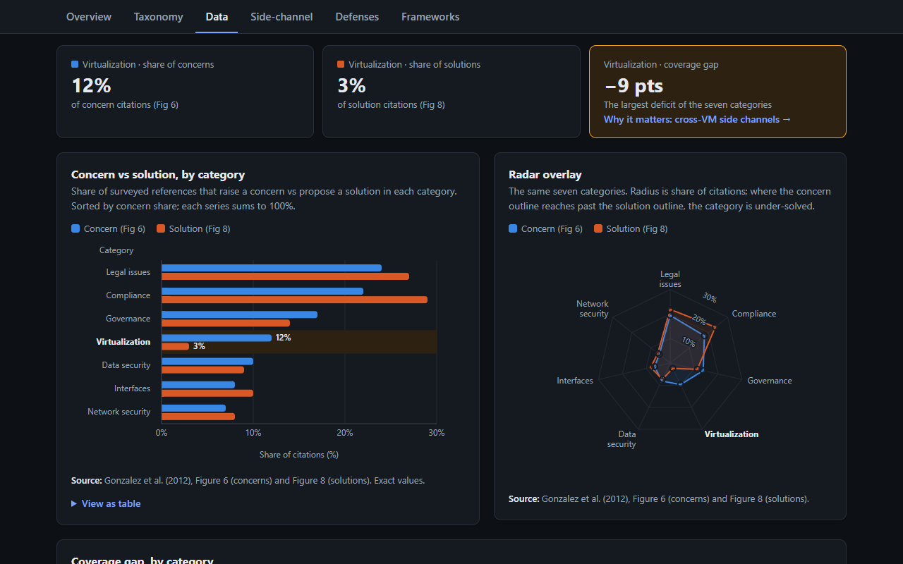
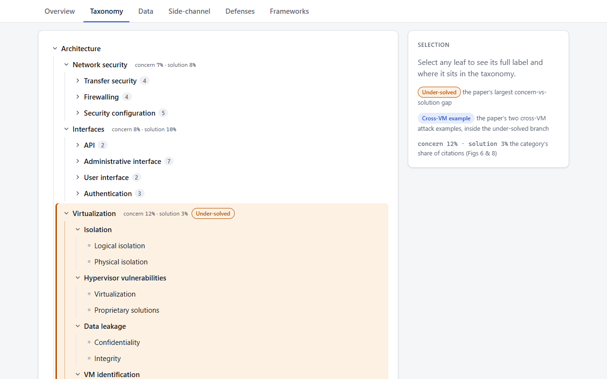
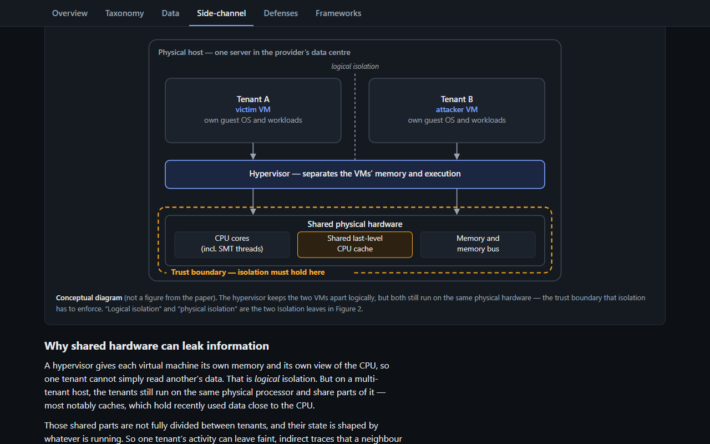

# Cloud Security Threat Lab

**Live demo: https://alpha08-prog.github.io/Cloud_Security/**

An interactive explorer for **Gonzalez et al. (2012), *A quantitative analysis of current
security concerns and solutions for cloud computing*** (Journal of Cloud Computing, 1:11).

The paper surveys 200+ references and counts, for each cloud-security concern, how often it
is raised versus how often a solution is proposed. Its headline finding: **virtualization is
the biggest unsolved gap — 12% of concern citations but only 3% of solution citations.**
Cross-VM / side-channel attacks sit inside that gap. This project makes the taxonomy, the
numbers, that gap, and the defenses explorable, with a conceptual cross-VM side-channel
explainer and its defenses as the centerpiece.



## Sections
- **Overview** — the concern-vs-solution thesis at a glance
- **Taxonomy explorer** — the four taxonomy trees (Figures 1–4), interactive
- **Data dashboard** — concern vs solution per category (Figures 6 & 8), radar, and the
  virtualization sub-breakdown (Figure 11)
- **Cross-VM side channels** — a labelled diagram of two co-resident VMs on shared hardware,
  a plain-English explanation of why that can leak information, and the virtualization
  defenses that address it
- **Defense matrix** — concrete modern controls answering each category of concern
- **Frameworks** — CSA, ENISA, and NIST summaries (Tables 1 & 2)

Each tab has its own URL (`#taxonomy`, `#data`, `#side-channel`, …), so you can link
straight to a section. The app supports light and dark themes and works down to phone width.

| Data dashboard | Taxonomy explorer | Side-channel explainer |
| --- | --- | --- |
|  |  |  |

## Run locally
Requires Node.js 22.12+ (CI uses Node 24).

```bash
npm install
npm run dev       # dev server at http://localhost:5173/
npm test          # data-integrity and helper tests (Vitest)
npm run lint      # oxlint
npm run build     # type-check + production build to dist/
npm run preview   # serve the build at http://localhost:4173/Cloud_Security/
```

## Tests
`npm test` runs checks that keep the UI faithful to the paper:
- the category shares match `docs/paper-content.md` exactly and each series sums to 100%
- every gap is `solution − concern`, and virtualization is the largest deficit (−9 pts)
- the sub-category and radar values are in range and place correctly in the taxonomy
- every category appears once in the taxonomy, the defense matrix, and the charts
- every virtualization control has its side-channel explanation

## Deploy
Every push to `main` runs `.github/workflows/deploy.yml`, which lints, tests, builds, and
publishes `dist/` to GitHub Pages. The production build uses the base path `/Cloud_Security/`
(set in `vite.config.ts`). If you fork or rename the repo, change that path to match.

One-time setup: in the GitHub repo, open **Settings → Pages** and set **Source** to
**GitHub Actions**.

## Project layout
```
docs/paper-content.md   # canonical extracted content — the source of truth
docs/screenshots/       # images used in this README
src/data/               # typed content mirrored from paper-content.md (+ data.test.ts)
src/sections/           # one folder per section
src/components/         # app shell and shared chart components
src/lib/                # chart view-models and formatting helpers
.github/workflows/      # GitHub Pages deployment
```

## A note on the side-channel section
The side-channel section is **explanatory and defense-focused**: a static diagram, a
conceptual explanation (co-residency plus imperfect isolation of shared hardware), and the
defenses. It contains no attack and no simulation of one. The defenses are current best
practice, not taken from the 2012 paper.

## Credit
Based on an open-access (CC BY 2.0) paper by Gonzalez et al. (2012). All concept and figure
data is attributed to that work in `docs/paper-content.md`.
