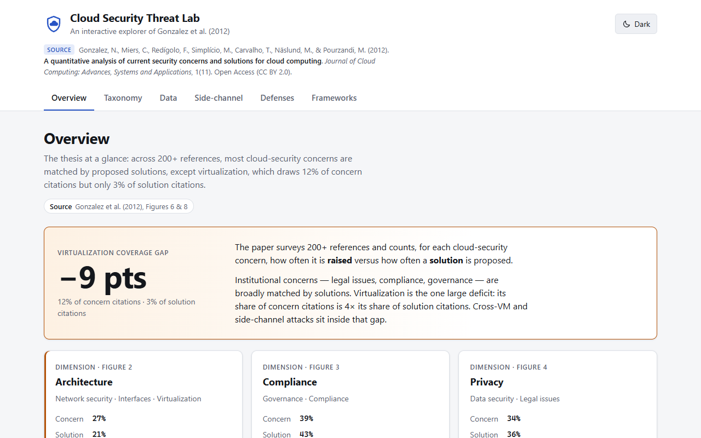

# IsoLab: Cloud Isolation Lab

[](https://github.com/alpha08-prog/Cloud_Security/actions/workflows/ci.yml)
**Live site: https://alpha08-prog.github.io/Cloud_Security/**

## Current research basis (2024–2025)

IsoLab now combines provider-side interference observation motivated by
[Horchulhack et al. (2024)](https://doi.org/10.1016/j.jnca.2024.103839) with selected defenses from
[Jarkas et al., ACM Computing Surveys (2025)](https://doi.org/10.1145/3715001).
The new implementation adds SHA-256 startup integrity and executable/entry-script allowlisting
for hardened tenant workloads (a selected aspect of ACM M2), a six-theme executable defense
crosswalk, ten independent configuration-fault challenges (E4), and five startup challenges (E5).
It does not reproduce the 2024 neural classifiers or validate the whole ACM exploit taxonomy.

```powershell
python scripts/lab.py up hardened
python scripts/lab.py research   # saved-snapshot E4 + isolated-subprocess E5; writes results/research/study.json
python scripts/lab.py integrity  # clean/altered files in three built images; six container checks
npm.cmd run dev
```

Open the Research tab. See [the revised demo and protocol](docs/research/DEMO.md) and
[the IEEE manuscript](docs/research/IsoLab_Research_Paper.pdf).
E1–E3 published measurements retain their October provenance; the new control was added in November.

## Historical motivation

**Gonzalez et al. (2012)**, *A quantitative analysis of current security concerns and solutions
for cloud computing* (Journal of Cloud Computing 1:11), counted 200+ references and found one
area where solutions lag concerns: **virtualization**, with 12% of concern citations but 3% of
solution citations. Within it, isolation and cross-VM attacks are almost unanswered (Figure 11).
The paper's future-work section (p.16) says what the missing solution should do:

> "…employ **virtual machine identification** [R1], provide an **adequate separation of
> dedicated resources** [R2] combined with a **constant observation of shared ones** [R3], and
> **examine any attempt of exploiting cross-VM and data leakage** [R4]."

IsoLab originally adapted those requirements to containers. R1–R4 and the five-axis grouping
retain that historical attribution. A separate literature-counting extension remains unfinished:
blind human annotation is incomplete, so its trend claims are excluded from the main paper.



## What's in it

| Part | What it does |
|---|---|
| `testbed/` | A Docker Compose multi-tenant cloud: three tenants and a hardened provider plane, in two profiles (**insecure** lift-and-shift vs **hardened**, the paper-derived controls). CPU sets are planned from the host's real core/thread topology so no two tenants share a physical core. |
| `auditor/` | **cloudaudit** (Python, FastAPI, pydantic). It has: <ul><li>**30 checks**, each mapped to a Figure 11 axis, to R1–R4, to the paper's taxonomy nodes, and to CSA / ENISA / NIST</li><li>severity-weighted coverage scores, time-boxed waivers and a policy gate</li><li>JSON, SARIF and a console report</li><li>a per-tenant **cgroup v2 + pressure-stall (PSI)** exporter</li><li>**live detections** from the engine event stream</li><li>a **canary** decoy</li></ul> It only talks to the engine through a read-only socket proxy. |
| `monitor/` | Prometheus rules and a provisioned Grafana dashboard: the live view during a demo. |
| `scripts/lab.py` + `experiments/` | A standard-library orchestrator for the whole lab, and three pre-registered experiments: **E1** noisy neighbour (SLO under CPU contention), **E2** segmentation and escape-surface matrix, **E3** detection validation. |
| `experiments/replication/` + `replication/` | **Unfinished optional extension.** Frozen classifier and literature corpus; blind human annotation is incomplete. No validated literature-trend result is claimed in the main paper. |
| `src/` | The site, one tab per step: **The gap → Requirements → The system → Results**, plus the paper in an appendix. It imports the published results at build time. |
| `.github/workflows/ci.yml` | Lint and contract tests, then both profiles run on a fresh runner with their gates (the hardened gate blocks the deploy). Uploads SARIF to code scanning and deploys to Pages. |

## Results

From `results/published/`, measured on a 6-core/12-thread laptop (Docker Desktop, WSL2). The
Results tab shows them in full.

| | Insecure | Hardened |
|---|---|---|
| Policy gate (fail on ≥ high) | fails: 15 blocking checks | **passes** (2 waived host issues) |
| Isolation coverage, 30 checks | 20% | **94%** |
| E2: isolation paths open | 12 / 12 | **0 / 12** (controls 3/3) |
| E1: tenant A p99 alone → with a noisy neighbour | 4.3 → 16.5 ms (×3.8) | **4.6 → 5.6 ms (×1.22)** |
| E3: isolation-breaking actions detected | 8/8, 0 false positives | **7/7**, 0 false positives, median 95 ms |

Published run: full variant: E1 at 50 req/s, 15 s warm-up + 90 s measured, 3 interleaved repetitions per arm; E3 quiet window 120 s. Commit `dffa2c70c553`. Pre-registered hypotheses: 6 of 7 supported (H3 inconclusive: optional arm not run).

Hypotheses and pass criteria were written down before any run (`docs/experiments.md`); verdicts
are computed by `lab.py publish`.

**Replication (2013–2026).** Protocol, hypotheses HR1–HR5 and changelog: `docs/replication.md`.
Status: snapshots, frozen classifier and validation sample are committed; results are published
(Results → Replication) once the blind labels are complete. Dev-set agreement (tuning sets,
optimistic): macro-F1 0.74, mean κ 0.69, type κ 0.63.

## Run it

You need Docker Desktop (or Docker Engine with cgroup v2), Python 3.10 or newer (standard
library only), and Node 22.12+ for the site.

```bash
python scripts/lab.py doctor             # Docker, cgroup v2, ports, CPU topology
python scripts/lab.py up hardened         # or: up insecure (read testbed/README.md first)
python scripts/lab.py audit hardened      # 30 checks -> console + results/runs/.../audit.{json,sarif}
python scripts/lab.py demo canary         # one benign trigger, live (also: exec, drift, noisy, ...)
# Grafana: http://127.0.0.1:3000 (anonymous viewer)
python scripts/lab.py run-all             # both profiles: audit, E3, E2, E1, gates (~45 min)
python scripts/lab.py publish             # merge, test hypotheses, validate -> results/published
python scripts/lab.py down

python scripts/lab.py rep status          # replication: snapshot hashes, freeze, labelling progress
python scripts/lab.py rep annotate        # the blind labelling form (127.0.0.1 only, resumable)
python scripts/lab.py rep analyze         # validity, shares, intervals, HR1-HR5 (needs every label)
python scripts/lab.py rep publish         # -> results/published/replication.json, schema-checked

python scripts/lab.py test                # ruff + pytest (auditor, orchestrator), in a container
npm install && npm test && npm run dev    # the site, at http://localhost:5173/
```

## How it's kept honest

- **Pre-registered experiments.** Protocol changes go in a changelog with a reason before the
  data they affect. Runs that break the validity rules are discarded: dropped iterations, more
  than 1% failures, or noise that didn't happen.
- **Controls in both directions.** The insecure profile is a negative control: CI fails if the
  auditor stops catching it. E2 includes positive controls, so "blocked" can't just mean
  "broken".
- **One contract, two languages.** The pydantic models generate JSON Schemas. The site validates
  every published file against them, resolves every taxonomy and framework reference, and
  recomputes every score in TypeScript, which must equal the Python result.
- **Waivers are visible.** Two host-level issues on Docker Desktop (CPU microcode, user
  namespaces) are waived with a reason and an expiry. They earn no coverage credit, and a waiver can be scoped
  (`covers`) to the exact CPU flaws observed, so a newly reported flaw fails the gate again.
- **The replication is frozen before it is checked.** The classifier's two files are hashed
  before the validation sample is drawn, and any later edit aborts the analysis. The annotator
  sees only titles and abstracts, in shuffled order, with hidden repeats. `rep analyze` refuses
  to run until every screen is labelled. Post-freeze changes are logged as deviations (D1 so
  far, CVE supplement only).
- **Defensive only.** Configuration auditing, load testing of the victim's own latency,
  read-only reachability probes and benign detection triggers. There is no attack code, no
  side-channel measurement and no secret recovery (see `CLAUDE.md` and `testbed/README.md`).

## Docs

- [Project completion audit](docs/project-audit.md): rubric mapping, verified checks, fixes and remaining submission tasks.
- [IEEE research paper PDF](docs/research/IsoLab_Research_Paper.pdf), [editable IEEEtran LaTeX manuscript](docs/research/IsoLab_IEEE.tex), and [recomputed historical evidence](docs/research/evidence.json). Authors: Atharva Agrawal and Niti Priya. The revised paper reports historical E1–E3, new E4–E5, and selected defenses from the two recent papers. It excludes the unfinished blind literature extension.
- `scripts/research_evidence.py` recomputes manuscript statistics from committed results; `scripts/build_research_paper.py` generates vector figures with ReportLab and compiles the official IEEEtran conference manuscript using Tectonic or pdflatex. These do not overwrite historical measurements.

- `docs/paper-content.md`: everything taken from the paper (figures, quotes, the p.16 brief).
- `docs/architecture.md`: components, the requirement mapping, the data contract, design
  decisions.
- `docs/experiments.md`: E1–E3 protocol, hypotheses and changelog.
- `docs/replication.md`: the replication's pre-registered protocol, annotation guidelines,
  hypotheses HR1–HR5, changelog and deviations.
- `docs/checks.md`: the generated check catalogue.
- `docs/viva-notes.md`: the demo script and expected questions.

## Limitations

- **Containers stand in for VMs.** The CSA guidance cited by the paper treats multi-tenancy as
  the essential characteristic, and a shared kernel is the harder isolation case.
- **One host.** On Docker Desktop the "host" is a Hyper-V VM, so SMT topology is indicative and
  microcode is out of reach.
- **Different units.** The paper's Figure 11 counts citations; IsoLab's radar is check coverage.
  The site never plots them on one scale.
- **The replication reads abstracts, not papers.** It uses keyword rules validated against one
  annotator (also an author), and an academic corpus where the survey mixed academic and
  industry sources. Figures 5, 7 and 11 are read from charts, so they are approximate. All of
  this is reported alongside the numbers.
- **CI E1 is a smoke test.** Two-core runners can't separate tenants onto physical cores
  (waived there), so CI latency numbers are informative only.

## Credit

Based on the open-access (CC BY 2.0) paper by Gonzalez, Miers, Redígolo, Simplício, Carvalho,
Näslund and Pourzandi (2012). Paper content is attributed in `docs/paper-content.md`; the
requirements' interpretation, the system and all measurements are this project's.
