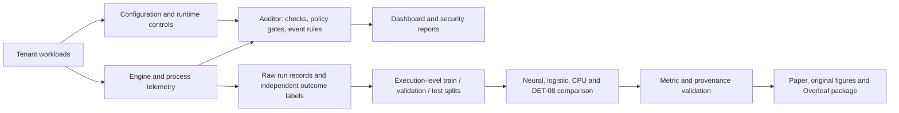

# IsoLab: Container Isolation and Interference Evaluation

[](https://github.com/alpha08-prog/Cloud_Security/actions/workflows/ci.yml)

**An executable cloud-security lab with a completed 160-run comparison of resource isolation and interference detection.**

[Research paper](docs/research/IsoLab_Research_Paper.pdf) · [Overleaf-ready source](docs/research/IsoLab_Overleaf.zip) · [Pilot report](docs/research/pilot-report.md) · [Interactive dashboard](https://alpha08-prog.github.io/Cloud_Security/)

## Start here: evaluator guide

1. **Read the paper:** the numerical comparison distinguishes published 2024 results, our locally adapted baseline, and our own measured methods.
2. **Inspect the evidence:** [pilot summary](docs/research/pilot-evidence.json), [full report](docs/research/pilot-report.md), and [raw evidence ZIP](docs/research/IsoLab_Pilot_Evidence.zip).
3. **Check reproducibility:** [protocol and deviations](docs/research/comparison-protocol.md), [runner and instructions](experiments/comparison/README.md), and [independent publication audit](scripts/pilot_publication.py).
4. **Explore the implementation:** [auditor](auditor/), [testbed](testbed/), [monitoring](monitor/), and [interactive dashboard source](src/). The extended security/research implementation is also available on the [research branch](https://github.com/alpha08-prog/Cloud_Security/tree/replication).

## What the project demonstrates

- Thirty configuration checks with severity-weighted posture scores, explicit waivers, policy gates, JSON and SARIF output.
- Tenant resource controls, network/storage boundaries, cgroup v2/PSI observation, engine-event rules, and a metadata canary.
- Historical boundary and detection experiments, plus startup-integrity and configuration-fault studies in the extended research implementation.
- A **completed 160-run pilot** with payments, Spark RandomForest and Spark SVM; independently separated training, validation and test executions.
- A measured comparison of a **2024-inspired autoencoder/LSTM adaptation**, an inexpensive resource-logistic extension, a CPU threshold, and the existing DET-08 rule.
- Original vector figures and tables generated from recorded measurements, with source hashes and auditable prediction records.

## Verified pilot results

The pilot finished on **17 November 2026**, in **4 hours 29 minutes**, on one Docker Desktop/WSL2 host with 12 logical CPUs. There were ten independent runs per condition. Smoke runs were excluded.

### Resource protection under sustained contention

| Workload and metric | Shared configuration | Hardened adaptation | Reduction |
|---|---:|---:|---:|
| Payments: request p99 | 10.997 ms | 4.287 ms | **61.0%** |
| Spark RF: median job duration | 1103.983 ms | 716.498 ms | **35.1%** |
| Spark SVM: median job duration | 901.566 ms | 539.942 ms | **40.1%** |

These are median run summaries. The resource-control adaptation also reduced competing-workload throughput by approximately **64–66%**. It protects the victim by restricting competition; it is not a cost-free efficiency gain or a performance improvement over a detector.

### Held-out detection comparison

| Method | Payments F1 (24 test runs) | RF F1 (12) | SVM F1 (12) |
|---|---:|---:|---:|
| Adapted AE/LSTM baseline | 0.941 | 1.000 | 0.857 |
| **IsoLab resource-logistic extension** | **1.000** | **1.000** | 0.400 |
| CPU threshold | 0.875 | 1.000 | 0.667 |
| Existing IsoLab DET-08 | 0.500 | 1.000 | 0.857 |

The lightweight extension improved the payments point estimate and tied RF, but lost accuracy on SVM. Its measured fitting time was **0.0033–0.0130 seconds**, versus **43.16–85.78 seconds** for the neural pipeline. Timings are single fitting measurements, not a repeated speed benchmark. Zero observed false positives came from only 15/9/8 negative test runs; it is not an operational false-alarm guarantee. Full confusion counts, AUC, timing and limitations are in the report.

**Research conclusion:** resource isolation offers measurable protection at a throughput cost, while detector choice depends on workload. The pilot does not establish general superiority over the 2024 paper.

## Architecture and evidence flow



The operational auditor uses a restricted socket proxy. The separate experimental collector is a trusted host observer requiring Docker API access, host PID visibility and read-only cgroups; it is not a drop-in production deployment.

## Relationship to the reference papers

The principal quantitative reference is [Horchulhack et al. (2024), Detection of quality of service degradation on multi-tenant containerized services](https://doi.org/10.1016/j.jnca.2024.103839).

Our baseline retains its documented neural architecture but uses **32 common local aggregate features**, a single host and smaller workloads, rather than the original 411-feature distributed service pipeline. Scaling, temporal windows and stopping choices are explicitly documented. Original-paper values are contextual and are not subtracted from our local results to claim improvement.

[Jarkas et al. (2025)](https://doi.org/10.1145/3715001) supplies security-defense background. [Gonzalez et al. (2012)](https://doi.org/10.1186/2192-113X-1-11) is the historical source of the R1–R4 requirement labels. The paper also positions the work against PARTIES, Caladan, empirical container-security studies and official platform documentation: **22 references** in total.

## Historical security evidence: separate from the pilot

| Evidence | Recorded outcome |
|---|---|
| E1: historical noisy-arm p99 | 16.463 → 5.617 ms; 65.9% reduction |
| E2: tested exposure paths | 12/12 closed; 3/3 positive controls retained |
| E3: expected triggers | 8/8 insecure and 7/7 hardened accepted by the protocol |
| E4: independent configuration faults | 10/10 specified faults detected |
| E5: startup challenges | Clean case accepted; four invalid cases rejected |

Historical E1–E3 measurements are from October 2026; the new pilot is from November. They use different configurations and workloads and must not be pooled. These checks do not establish arbitrary exploit resistance, side-channel resistance or cryptographic attestation.

## Run the lab

Prerequisites: Docker with Linux containers/cgroup v2, Python 3.10+, and Node 22.12+ for the dashboard.

```bash
python scripts/lab.py doctor
python scripts/lab.py up hardened
python scripts/lab.py audit hardened
python scripts/lab.py demo canary
npm install
npm run dev
# Stop the lab when finished:
python scripts/lab.py down
```

The dashboard presents the historical published lab results. The new classifier pilot is delivered in the paper and evidence artifacts; it is not silently substituted into the historical dashboard.

## Reproduce or audit the matched pilot

The [comparison README](experiments/comparison/README.md) gives the Docker commands. The pilot has a 5.5-hour collection limit and an eight-hour total budget. Use a new output directory for a rerun and keep the machine awake. Its scripts create only the named comparison workloads and retain failed-run evidence.

For an evidence-only audit, extract [IsoLab_Pilot_Evidence.zip](docs/research/IsoLab_Pilot_Evidence.zip) into the repository root; it contains the `results/comparison/pilot01/` directory. Then:

```bash
python scripts/pilot_publication.py
```

The audit checks the complete matrix, recorded hashes, split coverage, labels, confusion metrics and recomputed request/job summaries. The evidence ZIP includes raw measurements and predictions but excludes large trained-model binaries; retraining commands generate those locally.

### Validation performed

- **160 run summaries and 12 method/workload summaries independently audited.**
- Five comparison-utility tests passed; neural forward/backward smoke check passed.
- IEEE PDF checked for citations, links, embedded fonts and page layout.
- Historical Python/frontend checks are documented separately; their old counts are not presented as a rerun of the new pilot code.

## Overleaf submission package

Download [IsoLab_Overleaf.zip](docs/research/IsoLab_Overleaf.zip), create an Overleaf project from the ZIP, and select **IsoLab_IEEE.tex** as the main file with **pdfLaTeX**. The package contains all required .tex inputs, vector figure PDFs and the inline bibliography. No external dataset download is needed to compile it.

Use the share link generated by **your Overleaf project** for submission. This repository does not invent an Overleaf project URL. Check your venue's page limit and anonymization requirements before submitting the current 12-page IEEE-format manuscript.

## Limits and next research steps

This is a single-host pilot with 24/12/12 held-out runs, short windows, fixed generated Spark data and a small feature set. Detector scores are offline run classifications, not a matched online detection-delay benchmark. Model-fitting cost is measured; monitoring-disabled overhead and economic consolidation cost are not. The CPU quota and placement effects are not separately identified in this pilot.

Next steps are new held-out workloads, robust validation-selected thresholds, burst-aware policies, individual-control ablations and multi-host evaluation. The optional literature-counting extension remains unfinished and is not used to support the paper's empirical claims.

## Repository map

| Location | Purpose |
|---|---|
| auditor/ | Configuration checks, policy and runtime observation |
| testbed/ | Tenant images and Compose profiles |
| monitor/ | Prometheus and Grafana configuration |
| experiments/comparison/ | Bounded collection, training, evaluation and reporting |
| experiments/isolab/comparison*.py | Metrics, split validation and model architecture |
| scripts/pilot_publication.py | Independent result audit and publication artifacts |
| docs/research/ | Paper, Overleaf source, protocol and evidence package |
| src/ | Interactive research dashboard |

Authors: **Atharva Agrawal and Niti Priya**, Indian Institute of Information Technology Dharwad.
